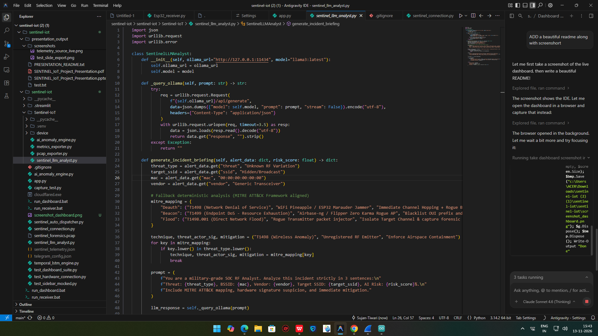

<div align="center">


# 🛡️ SENTINEL-IoT
### Airspace Security Operations Center (SOC) Dashboard

[](https://python.org)
[](https://streamlit.io)
[](https://espressif.com)
[](LICENSE)
[]()
[](https://attack.mitre.org)

> **Real-time WiFi airspace monitoring, AI-powered threat detection, and SOC-grade incident response — powered by ESP32 hardware.**

---



</div>

---

## 🚀 What is SENTINEL-IoT?

**SENTINEL-IoT** is a military-grade airspace monitoring platform that uses an **ESP32 microcontroller** to scan the WiFi spectrum and feeds real-time data into a **Streamlit SOC dashboard** with AI-powered threat detection, MITRE ATT&CK mapping, and automated alerting.

Think of it as a **personal SOC in a box** — plug in an ESP32, launch the dashboard, and instantly gain situational awareness of every wireless device in your airspace.

---

## ✨ Key Features

| Feature | Description |
|---------|-------------|
| 📡 **Real-Time WiFi Scanning** | ESP32 scans all 2.4GHz channels every ~60s and streams results to dashboard |
| 🧠 **AI Anomaly Detection** | LSTM temporal engine + rule-based AI flags Deauth, Beacon Flood, Rogue AP attacks |
| 🗺️ **MITRE ATT&CK Mapping** | Auto-maps threats to T1498, T1499, T1498.001 and more |
| 🔥 **Live Threat Feed** | Scrolling SOC-style incident log with severity classification |
| 📊 **Dual-Sector Airspace View** | Sector 1: Infrastructure APs · Sector 2: Mobile Hotspots |
| 🌐 **Global Access** | Cloudflare tunnel for worldwide dashboard access — no port forwarding |
| 🤖 **LLM Analyst** | Ollama-powered LLM generates natural-language incident briefings |
| 📲 **Telegram Alerts** | Auto-dispatches threat alerts to your Telegram bot |
| 🔌 **Auto COM Detection** | Auto-discovers ESP32 on any COM port (CH340/CP210x priority) |
| 📦 **PCAP Export** | Forensic packet capture export for Wireshark analysis |

---

## 🏗️ System Architecture

```
┌─────────────────────────────────────────────────────────────┐
│                    SENTINEL-IoT SYSTEM                       │
├──────────────┬──────────────────────┬───────────────────────┤
│  ESP32 MCU   │   Python Bridge      │   SOC Dashboard       │
│              │                      │                        │
│  WiFi Scan   │  Esp32_receiver.py   │  app.py (Streamlit)   │
│  CH340 USB   │  ──────────────────► │  ──────────────────►  │
│  Serial Out  │  sentinel_telemetry  │  Live Threat Feed     │
│              │  .json               │  AI Anomaly Engine    │
│              │                      │  MITRE ATT&CK Map     │
└──────────────┴──────────────────────┴───────────────────────┘
                                              │
                              ┌───────────────┼───────────────┐
                              │               │               │
                        Telegram Bot    LLM Analyst    Cloudflare Tunnel
                        (Alerts)       (Ollama)        (Global Access)
```

---

## 📁 Project Structure

```
sentinel-iot/
├── 📱 app.py                        # Main SOC Dashboard (Streamlit)
├── 🔗 sentinel_connection.py        # Hardware status & connection logic
├── 🧠 ai_anomaly_engine.py          # AI threat detection rules
├── ⏱️  temporal_lstm_engine.py       # LSTM time-series anomaly model
├── 🤖 sentinel_llm_analyst.py       # LLM-based incident analyst (Ollama)
├── 📡 sentinel_auto_dispatcher.py   # Telegram auto-alert dispatcher
├── 📦 Sentinel-IoT/
│   ├── 📟 device/
│   │   └── Esp32_receiver.py        # ESP32 serial bridge receiver
│   ├── ai_anomaly_engine.py
│   ├── metrics_exporter.py          # Prometheus metrics export
│   ├── pcap_exporter.py             # Forensic PCAP export
│   └── sentinel_llm_analyst.py
├── 🖥️  run_dashboard.bat             # One-click dashboard launcher
├── 📡 run_receiver.bat              # One-click receiver launcher
├── 🧪 test_dashboard_suite.py       # Dashboard test suite
├── 🧪 test_hardware_connection.py   # Hardware connection tests
└── 📋 assets/
    └── dashboard_preview.png        # Dashboard screenshot
```

---

## 🛠️ Hardware Requirements

| Component | Specification |
|-----------|--------------|
| **Microcontroller** | ESP32 (any variant — DevKit, WROOM, WROVER) |
| **USB-Serial Chip** | CH340 or CP2102 (auto-detected) |
| **Host Machine** | Windows 10/11 with Python 3.11+ |
| **USB Cable** | USB-A to Micro-USB or USB-C |

---

## ⚡ Quick Start

### 1. Clone the Repository
```bash
git clone https://github.com/Sujan-Tiwari/SENTINEL-IoT-.git
cd SENTINEL-IoT-
```

### 2. Create Virtual Environment
```bash
python -m venv Sentinel-IoT/.venv
Sentinel-IoT\.venv\Scripts\activate
pip install streamlit pyserial requests
```

### 3. Flash ESP32 Firmware
Upload the WiFi scanner sketch to your ESP32 via Arduino IDE. The firmware:
- Scans all WiFi channels every ~60 seconds
- Outputs: `Scan #N: X networks, SD log OK\n` over Serial at 115200 baud

### 4. Launch the Dashboard
```bash
# Option A — One-click launcher
run_dashboard.bat

# Option B — Manual
python -m streamlit run app.py --server.port 8501 --server.address 0.0.0.0
```

### 5. Launch the ESP32 Receiver
```bash
# Option A — One-click launcher
run_receiver.bat

# Option B — Manual (auto-detects COM port)
python Sentinel-IoT/device/Esp32_receiver.py --port AUTO --baud 115200
```

### 6. Open the Dashboard
```
Local:   http://localhost:8501
Network: http://<your-ip>:8501
```

---

## 🌐 Global Access (Cloudflare Tunnel)

To expose the dashboard globally without port-forwarding:

```bash
# Download cloudflared and run:
cloudflared.exe tunnel --url http://localhost:8501
```

You'll get a public URL like `https://xyz.trycloudflare.com` — share it with anyone worldwide!

---

## 🧠 AI Threat Detection

SENTINEL-IoT detects the following attack patterns:

| Threat | MITRE ID | Detection Method |
|--------|----------|-----------------|
| **Deauth Attack** | T1498 | Sudden client drop + frame burst |
| **Beacon Flood** | T1498.001 | High SSID count anomaly |
| **Rogue AP** | T1557 | SSID spoofing + BSSID mismatch |
| **Endpoint DoS** | T1499 | Resource exhaustion pattern |
| **Evil Twin** | T1557.002 | Duplicate SSID detection |
| **WiFi Jammer** | T1498 | Channel activity collapse |

---

## 📊 Dashboard Sections

```
┌─────────────────────────────────────┐
│  🛡️  SENTINEL-IoT SOC Dashboard      │
├─────────────────────────────────────┤
│  📡 Hardware Status   🔴/🟢 Live    │
│  📊 Scan Statistics   Networks: N   │
│  🗺️  Sector 1 — Infrastructure APs  │
│  📱 Sector 2 — Mobile Hotspots      │
│  🔥 Live Threat Feed                │
│  📈 Signal Strength Heatmap         │
│  🤖 AI Incident Briefing            │
└─────────────────────────────────────┘
```

---

## 🔧 Configuration

### Telegram Alerts
Create `telegram_config.json` (excluded from git):
```json
{
  "bot_token": "YOUR_BOT_TOKEN",
  "chat_id": "YOUR_CHAT_ID",
  "auto_alert_enabled": true
}
```

### Streamlit Config (`.streamlit/config.toml`)
```toml
[server]
headless = true
address = "0.0.0.0"
port = 8501
```

---

## 🧪 Testing

```bash
# Run full dashboard test suite
python test_dashboard_suite.py

# Test hardware connection
python test_hardware_connection.py

# Test sidebar (mocked)
python test_sidebar_mocked.py
```

---

## 🤝 Contributing

1. Fork the repository
2. Create your feature branch: `git checkout -b feature/AmazingFeature`
3. Commit your changes: `git commit -m 'Add AmazingFeature'`
4. Push to the branch: `git push origin feature/AmazingFeature`
5. Open a Pull Request

---

## 📜 License

Distributed under the MIT License. See `LICENSE` for more information.

---

## 👨‍💻 Author

**Sujan Tiwari**
- GitHub: [@Sujan-Tiwari](https://github.com/Sujan-Tiwari)
- Project: [SENTINEL-IoT-](https://github.com/Sujan-Tiwari/SENTINEL-IoT-)

---

<div align="center">

**⭐ Star this repo if you found it useful!**

*Built with ❤️ for airspace security*

`ESP32` · `Streamlit` · `Python` · `AI` · `MITRE ATT&CK` · `IoT Security`

</div>
